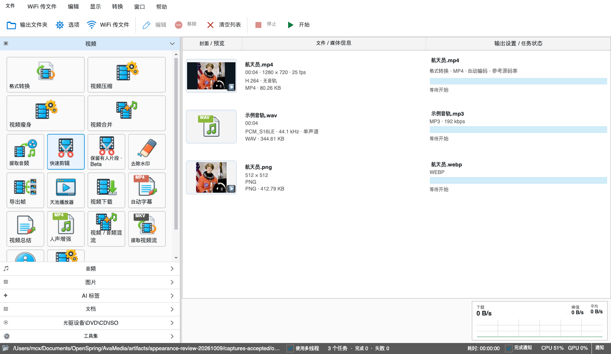
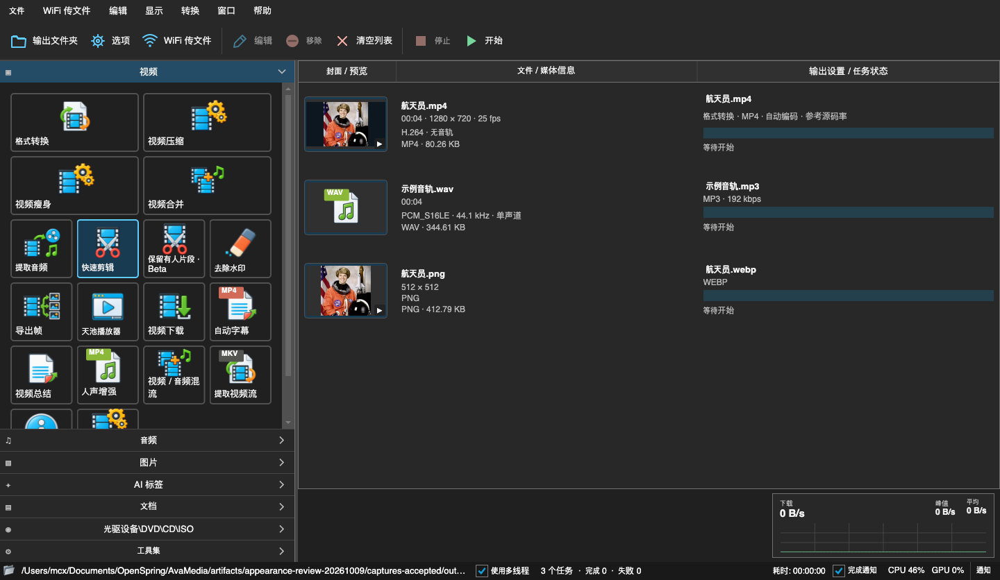
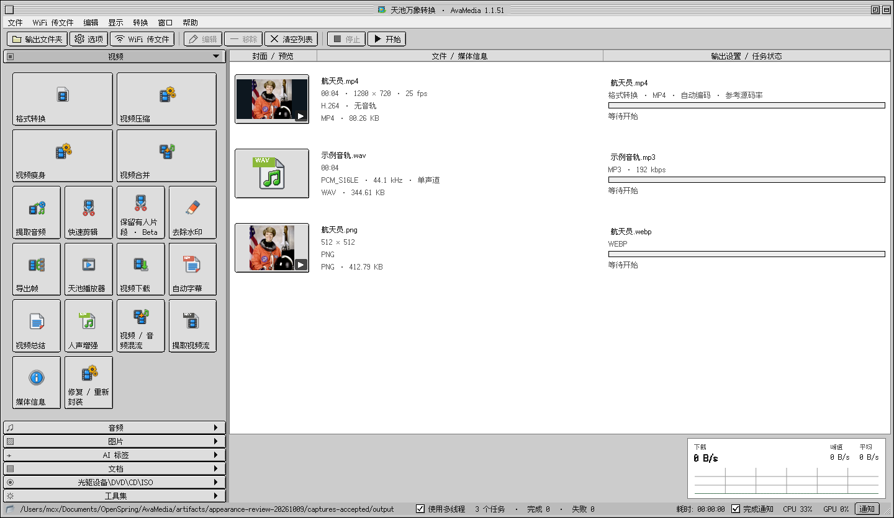
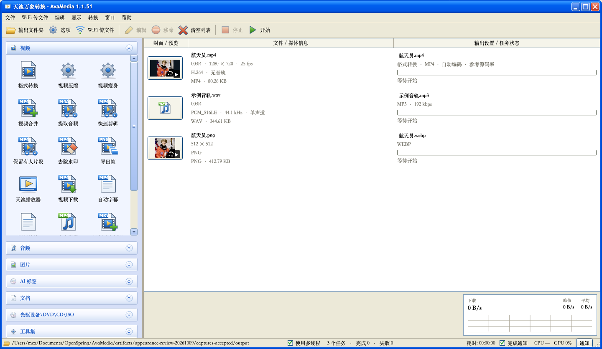
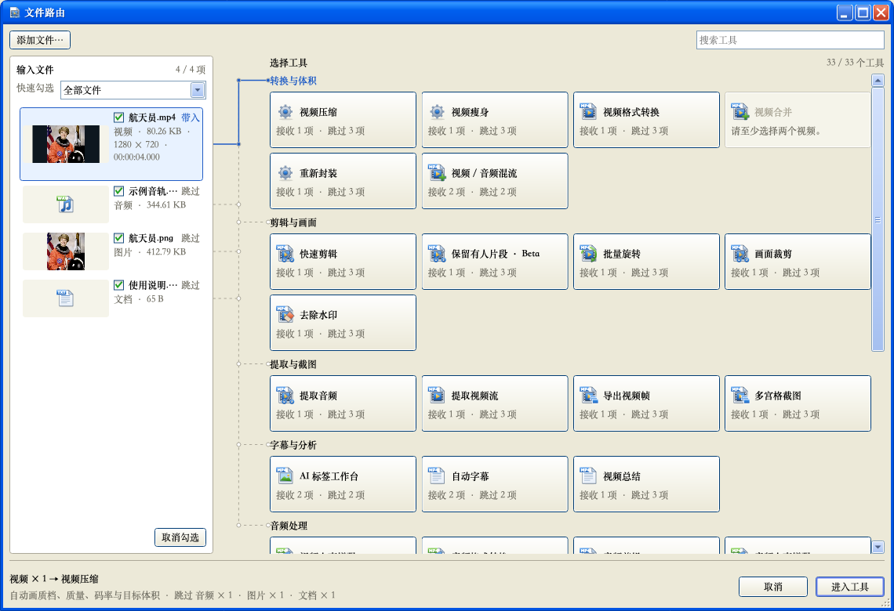
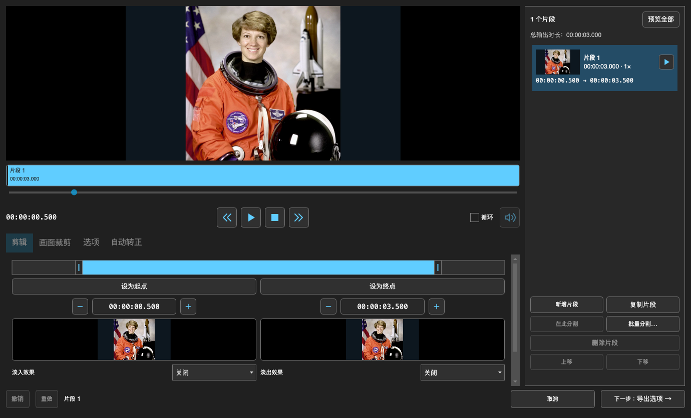
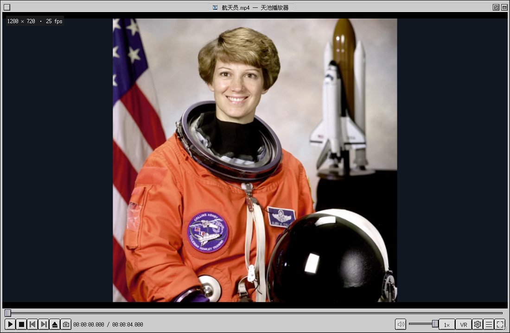
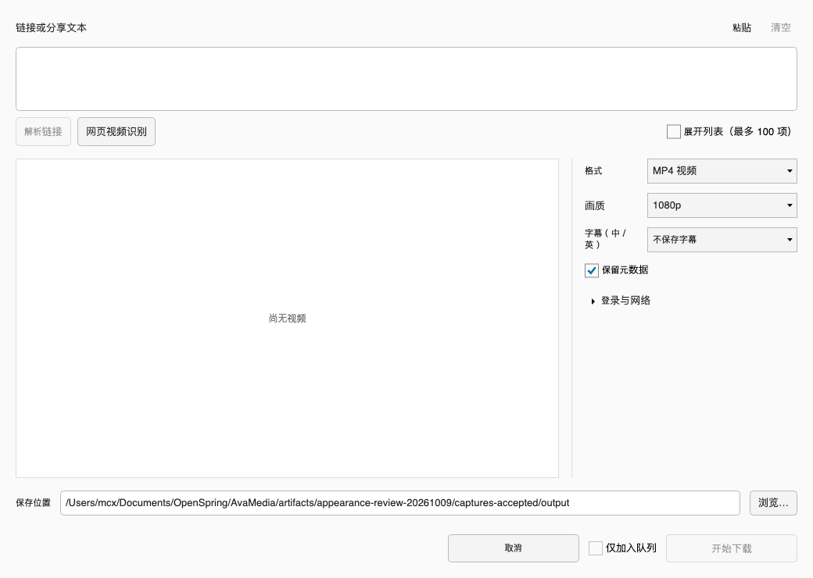

# AvaMedia

[简体中文](README.md) · **English**

[](https://github.com/mcxen/AvaMedia/actions/workflows/ci.yml)
[](https://github.com/mcxen/AvaMedia/actions/workflows/release.yml)
[](LICENSE)

An open-source desktop media toolkit for **Windows and macOS**, with a **Linux x64 development package**. Media conversion, compression, exports, downloads and AI analysis share a batch job queue; playback, image viewing and parameter editing use separate windows. Person segments, orientation detection, automatic subtitles, video summaries and media classification use a dedicated multi-page task window: one window pages through processing, interaction pages that need your input, and completion results, keeping page state, drafts and retry checkpoints with the job.

Built with **C#, .NET 8 and Avalonia 11**, with Simplified Chinese / English interfaces and Light, Dark, Mac OS 9 · Platinum and Windows XP · Luna skins. Regular windows in Light, Dark and follow-system modes use the system title bar; Mac OS 9 and Windows XP keep their classic skin chrome. AvaMedia is under active development; see the [feature notes](docs/FEATURES.md) for implementation and verification status.

[Download](https://github.com/mcxen/AvaMedia/releases/latest) · [MCP and remote web management](#mcp-and-remote-web-management) · [Screenshots](#screenshots) · [Run from source](#run-from-source) · [Report an issue](https://github.com/mcxen/AvaMedia/issues)

## Download and installation

Download the package for your platform from [GitHub Releases](https://github.com/mcxen/AvaMedia/releases/latest).

| Platform | File | Installation |
| --- | --- | --- |
| Windows x64 | `AvaMedia-<version>-win-x64-setup.exe` | Run the installer; includes shortcuts and an uninstaller |
| Windows x64 portable | `AvaMedia-<version>-win-x64-portable.zip` | Extract and run `AvaMedia.Desktop.exe` |
| macOS Apple Silicon | `AvaMedia-<version>-osx-arm64.dmg` | Open the DMG and drag `天池万象转换.app` into Applications |
| Linux x64 development package | `AvaMedia-<version>-linux-x64.tar.gz` | Extract and run `./avamedia`; requires a graphical desktop and system dependencies |

The macOS package targets **Apple Silicon (ARM64) and declares macOS 13.4 as its minimum version**. See the [platform notes](docs/PLATFORMS.md) for device verification status at that minimum version. The app uses ad-hoc signing and has not been Developer ID signed or notarized; you may need to allow it in System Settings → Privacy & Security on first launch.

**Windows / macOS** packages include FFmpeg / FFprobe, yt-dlp and QuickJS-NG. The native launcher checks for the required .NET 8 and ASP.NET Core runtimes. If either is missing, “Install runtime” downloads, verifies and installs them into the current user's directory; a complete existing runtime skips installation. First launch still asks for a skin and preferences before opening the app. Subsequent launches use the saved runtime location and settings. No administrator privileges, development SDK or separate Python installation is required; see [first-run setup](docs/FIRST-RUN-SETUP.md). The installed app's Chinese name is “天池万象转换”; repository and package names remain AvaMedia.

The **Linux** package includes the .NET runtime. Supply FFmpeg / FFprobe 9.x and yt-dlp separately, plus QuickJS-NG for downloads that require a JavaScript runtime. Embedded audio previews and browser sniffing are not implemented on Linux. Full desktop functionality and installation on real Linux distributions remain unverified; see the [Linux notes](docs/LINUX.md). Each Release includes package SHA256 checksums and links to the corresponding sources for the bundled Windows / macOS media tools.

## Features

| Feature | Capabilities |
| --- | --- |
| Video conversion and compression | MP4, MKV, WebM, AVI, MOV, TS and more; quality, bitrate or target size; Apple, NVIDIA, Intel and AMD hardware transcoding with software fallback, plus VAAPI on Linux; iPhone HDR to SDR |
| Video slimming | Samples real video, tries encodings and compares quality scores to estimate size and select export parameters; supports progressive SDR video and preserves sources |
| Editing and batch tools | Multiple files and clips; split by count, duration or timestamps; crop, rotate, mirror, speed and fades; batch cropping, orientation suggestions, renaming and contact sheets |
| Audio tracks and subtitles | Join, mux and extract streams; track selection, multiple audio tracks, sample rate, channels, volume and audio effects; burned-in or separate subtitle tracks |
| Automatic subtitles and voice enhancement | Offline transcription, text and timing review, style and position editing; choose SRT / ASS export or embedding into the video (soft / hard subtitles) before generation; audio and video voice denoising |
| Image conversion and compression | HEIC / HEIF input; JPEG, WebP and PNG compression; actual encoded sizes and before/after comparison; save compressed results only when smaller and preserve originals; image conversion, resizing and rotation |
| Tianchi Image Viewer | Folder and archive browsing, dual-page reading, animation, EXIF, slideshows, favorites and batch exports |
| PDF workspace | Page previews, selection, ordering, rotation, splitting and merging; images / TXT to PDF; aging effects, compression and text extraction |
| Automatic tagging | Image / video tags, Chinese word libraries, NSFW review, visual descriptions, scores and sampling curves, and TXT / JSON export |
| Automatic media organization | Group by tags, semantics, duration, pose, people or similar outfits; manual adjustments, folder previews, copying / moving and undo |
| Video summaries | Local or online AI combining subtitles / speech with optional frame analysis to produce summaries, chapters, analysis and reports |
| Keep segments with people · Beta | Multiple person detectors, excluded intervals, a segment editor (segment list, inspector, split / merge and detection-boundary snapping), plus source-format or re-encoded exports |
| Video downloads | Shared text, batch URLs, playlists, multipart videos and albums; quality, video / audio, subtitles, login state, proxies and retrying failed items; embedded browser sniffing on Windows / macOS |
| Tianchi Player | Separate player window, folder playlists, fullscreen, speed, track selection, frame stepping, snapshots and VR; optional native mpv for 4K / HDR and disc playback |
| WiFi file transfer | Scan a QR code to upload files from a phone's browser on the same local network, or share files from the computer for a phone to download |
| MCP and remote web management | AI clients can create media and AI jobs, query progress, read results and read or write native settings, online providers and local models through MCP; the browser can browse server files, configure and submit jobs using the desktop queue |
| Task queue and utilities | Parallel jobs, progress, stop, parameter editing, retry, logs, result recovery and retry checkpoints, automatic saving and import/export; jobs awaiting your input are ordered first among in-progress jobs; ZIP creation / extraction, DVD / VOB conversion and raw-data copying to ISO |

The sidebar has five categories: Video, Audio, Images, Documents and Utilities, with discs grouped under Utilities. Drop files into the main window to see compatible tools and accepted / skipped counts, select files by type and navigate with the keyboard. Confirm parameters to start immediately or only queue jobs. Quick Clip lets you edit first, then choose export settings for all clips; each clip produces a separate file by default.

The task list is grouped by status; running multi-page jobs show a segmented stage progress bar with hover details, and jobs awaiting your input are ordered first among in-progress jobs with a “handle now” action that reopens the same task window on the current page. Completed pages can be reviewed, revising a completed interaction page re-runs the later pages, and closing the window does not stop the queue. Dragging files out of a task row or task window only copies them and never moves the source.

### Practical limits

- **Fast Copy** clip starts depend on keyframes. Filters such as cropping and image rotation require re-encoding.
- **HEIC / HEIF** compression processes the primary still image and outputs JPEG / WebP / PNG. It does not preserve Live Photo video, depth maps or HDR gain maps.
- **PDF → DOCX / XLSX** extracts text rather than reconstructing the original layout. PDF aging and whole-page compression rasterize pages.
- **Watermark removal** interpolates from pixels around the selected area; it cannot reconstruct the actual obscured content. Remuxing does not guarantee recovery of damaged media.
- **AI and models**: required models download according to selected functions. Local frame analysis and summaries default to Huihui Qwen3.5 9B abliterated Q4 (about 6.55 GB), with an optional 4B basic tier (about 3.38 GB). Sampling and model outputs can miss or misinterpret content; review subtitles, tags, person segments and summaries. Online AI sends selected evidence and sampled frames. LaMa currently supports model installation only, with restoration inference still pending; its background download on startup is enabled by default and can be disabled in Settings → Local models.
- **Hardware and execution backends**: FFmpeg, ONNX, Whisper and llama.cpp probe the available backends per platform, and jobs and results record the backend actually used. GPU startup or inference failures fall back to CPU, incomplete GPU decode output is re-run in software, and software encoders such as libx264 stay on software. Some platform packages still ship CPU-only inference; hardware paths depend on drivers, device permissions and encoder support, and per-backend verification on real hardware is still pending.
- **Platform capabilities**: hardware transcoding depends on drivers, encoders, containers and inputs. Native mpv packages download separately on first use; the app's macOS mpv download requires macOS 14 or later. Browser sniffing on Windows requires an available WebView2 Runtime.
- Downloads depend on website, account, regional and network restrictions; see the [download notes](docs/VIDEO-DOWNLOAD.md).

## MCP and remote web management

Enable the service in **Settings → Remote management** and click **Apply**. The default port is `18920`:

- **Web toolbox**: open `http://127.0.0.1:18920/` to browse server files, choose tools and parameters, submit jobs, and inspect progress, logs and outputs.
- **MCP clients**: connect an AI client that supports Streamable HTTP to `http://127.0.0.1:18920/mcp` for media conversion, AI tagging, media organization, subtitles, summaries and other tools.
- **LAN access**: enable **Allow LAN connections**, apply the setting and use an address listed in Settings. The service does not require an access token; enable LAN access only on a trusted network.

The web client ships with the app. Media processing and model inference run on the computer hosting AvaMedia; file paths refer to that computer, and remote clients do not automatically upload their local files. Desktop, web and MCP share one job queue. Closing the browser does not cancel jobs, and the service continues when the main window is hidden in the tray. The background host still requires a desktop session. See the [MCP guide](docs/MCP.md) for connection configuration, persistent startup and tools, and the [web video parity notes](docs/WEB-VIDEO-PARITY.md) for implemented and pending workflows.

MCP calls Core and the desktop settings flows directly rather than simulating the interface: it reads the full parameter schema and job parameters for every feature, edits queued jobs that have not started, reads and writes native settings fields, online providers and local models, and exposes AI stage progress, classification resolutions and summary evidence. Interactive playback, image viewing and sign-in keep their desktop entry points.

## Screenshots

Historical Chinese-interface images from the **2026-10-09, v1.1.51** macOS development build. The main window, settings and tool layouts have since changed, and regular windows in the Light and Dark skins now use the system title bar, so the self-drawn title bars in these images no longer represent the current appearance. These images show appearance at that time and do not establish acceptance of current features or other platforms. The sample uses a [NASA public-domain photograph](tests/AvaMedia.BatchRotateTests/Fixtures/README.md).

| Light | Dark |
| --- | --- |
| [](docs/assets/screenshots/main-light.png) | [](docs/assets/screenshots/main-dark.png) |
| **Mac OS 9 · Platinum** | **Windows XP · Luna** |
| [](docs/assets/screenshots/main-macos9.png) | [](docs/assets/screenshots/main-winxp.png) |
| **File routing · Windows XP** | **Quick Clip · Dark** |
| [](docs/assets/screenshots/route-winxp.png) | [](docs/assets/screenshots/editor-dark.png) |
| **Player · Platinum** | **Video downloads · Light** |
| [](docs/assets/screenshots/player-macos9.png) | [](docs/assets/screenshots/download-light.png) |

Click an image for full size. The [complete gallery](docs/assets/screenshots/README.md) contains 44 captures across all four skins, including routing, settings, conversion, editing, export, playback and component previews. See the [appearance review](docs/acceptance/APPEARANCE-REVIEW.md) for scope and fixes.

## Run from source

Install the [.NET 8 SDK](https://dotnet.microsoft.com/download/dotnet/8.0); SDK selection is defined in [`global.json`](global.json). These steps include the remote web client and require the `wasm-tools` workload. A regular desktop build does not publish the web assets automatically.

```sh
git clone https://github.com/mcxen/AvaMedia.git
cd AvaMedia
dotnet workload install wasm-tools
dotnet publish src/AvaMedia.Browser/AvaMedia.Browser.csproj -c Release
dotnet build src/AvaMedia.Desktop/AvaMedia.Desktop.csproj -c Release
dotnet run --project src/AvaMedia.Desktop -c Release --no-build
```

Source builds need FFmpeg / FFprobe 9.x. Downloads also need yt-dlp, with QuickJS-NG for sites requiring a JavaScript runtime. Media-tool packages are linked in the Release notes. Builds without bundled tools accept paths in Settings → Advanced → External tools, or the `AVAMEDIA_FFMPEG`, `AVAMEDIA_FFPROBE`, `AVAMEDIA_YT-DLP` and `AVAMEDIA_QJS` environment variables. Tool discovery also searches the project's `.tools` directory, PATH and macOS Homebrew locations. Windows / macOS app packages use their bundled tools; missing bundled files produce a prompt to reinstall the complete package.

For desktop-only or MCP development, you can omit workload installation and Browser publishing; the web entry then reports that the web client has not been built. After changing Browser, publish it again and rebuild Desktop to copy the new web assets into the run directory.

For routine source changes, build affected projects and run necessary static checks. Documentation-only and asset-only changes do not require builds or tests. Run functional regression checks only when explicitly requested, following [`AGENTS.md`](AGENTS.md).

### Repository layout

| Path | Responsibility |
| --- | --- |
| [`src/AvaMedia.Core`](src/AvaMedia.Core) | Media models, validation, job planning, queue and processing; independent of Avalonia |
| [`src/AvaMedia.Controls`](src/AvaMedia.Controls) | Reusable controls, named themes and dynamic resource contracts |
| [`src/AvaMedia.FileUi`](src/AvaMedia.FileUi) / [`src/AvaMedia.MediaUi`](src/AvaMedia.MediaUi) | File browsing, path inputs and media editing controls shared by desktop and browser clients |
| [`src/AvaMedia.Mcp`](src/AvaMedia.Mcp) | MCP, web HTTP endpoints and server-side media previews connected to the host queue |
| [`src/AvaMedia.Desktop`](src/AvaMedia.Desktop) | Desktop windows, localization, skins, previews, playback and platform integration |
| [`src/AvaMedia.Browser`](src/AvaMedia.Browser) | Avalonia WebAssembly remote management client; published assets ship with the desktop app |
| [`src/AvaMedia.Bootstrap`](src/AvaMedia.Bootstrap) | Native first-run setup, runtime installation and app startup on Windows / macOS |
| [`website`](website) | Chinese / English landing page with features and screenshots; see the [website guide](website/README.md) for development and builds |
| [`scripts`](scripts) / [`.github/workflows`](.github/workflows) | Media-engine preparation, builds, packaging and releases |
| [`tests`](tests) | Focused verification programs and fixtures |

See the [architecture notes](docs/ARCHITECTURE.md) for interface boundaries, [`Branding.props`](Branding.props) for product naming, and [`UISPEC.MD`](UISPEC.MD) for UI conventions.

## Documentation and contributions

The detailed project documents below are currently in Chinese.

Browse the [documentation index](docs/README.md), [acceptance records](docs/acceptance/README.md), and [release records](docs/releases/README.md).

| Topic | Documents |
| --- | --- |
| Conversion and compression | [Video compression](docs/VIDEO-COMPRESSION.md) · [Video slimming](docs/VIDEO-SLIMMING.md) · [Image compression](docs/IMAGE-COMPRESSION.md) · [HEIC](docs/HEIC.md) · [TS video](docs/TS-VIDEO.md) · [GPU transcoding](docs/GPU-TRANSCODING.md) |
| Editing and playback | [Quick Clip](docs/QUICK-CLIP.md) · [Video editing](docs/VIDEO-EDITING.md) · [Batch crop](docs/BATCH-CROP.md) · [Batch rotate](docs/BATCH-ROTATE.md) · [Subtitles and tracks](docs/SUBTITLE-OPTIONS.md) · [Player](docs/PLAYER.md) |
| Files and utilities | [File routing](docs/MEDIA-ROUTING.md) · [WiFi transfer](docs/WIFI-TRANSFER.md) · [Image viewer](docs/IMAGE-VIEWER.md) · [PDF workspace](docs/PDF-WORKSPACE.md) · [Downloads](docs/VIDEO-DOWNLOAD.md) · [Batch tools](docs/BATCH-TOOLS.md) |
| Tasks and background | [Task management](docs/TASK-MANAGEMENT.md) · [Background tasks](docs/BACKGROUND-TASKS.md) · [Notifications](docs/NOTIFICATIONS.md) · [Cross-tool resource scheduling](docs/MEDIA-RESOURCE-SCHEDULING.md) |
| AI and models | [Automatic tagging](docs/MEDIA-AI.md) · [Media organization](docs/FOLDER-CLASSIFICATION.md) · [Video summaries](docs/VIDEO-SUMMARY.md) · [Person segments](docs/PERSON-CLIP.md) · [Subtitles and speech](docs/SPEECH-TOOLS.md) · [Model management](docs/MODELS.md) |
| Remote management | [MCP and web toolbox](docs/MCP.md) · [Web video parity status](docs/WEB-VIDEO-PARITY.md) |
| Development and releases | [Architecture](docs/ARCHITECTURE.md) · [Settings](docs/SETTINGS.md) · [Mac OS 9](docs/MACOS9-SKIN.md) · [Windows XP](docs/WINDOWS-XP-SKIN.md) · [Windows / macOS](docs/PLATFORMS.md) · [Linux](docs/LINUX.md) · [Git workflow](docs/GIT-WORKFLOW.md) · [Releases](docs/RELEASE.md) |

Report bugs and suggest improvements through [Issues](https://github.com/mcxen/AvaMedia/issues). For media-related problems, include your OS and app versions, input format, reproduction steps and error logs.

A `vMAJOR.MINOR.PATCH` tag triggers the Release workflow. Push routine commits normally; create a new version tag only after at least **1,200 changed lines of eligible code** have accumulated relative to the last published tag and relevant local checks pass. A corresponding `docs/releases/<version>.md` note must be committed first: regular CI checks the source version against the version notes before compiling, and the Release workflow verifies that the notes exist and are non-empty before building packages. Documentation, licenses, assets and generated files do not count. Published tags stay unchanged. See the [Git workflow](docs/GIT-WORKFLOW.md).

## License

Copyright © 2026 AvaMedia contributors. Original code, tests, documentation and icons are licensed under **AGPL-3.0-only**; see [LICENSE](LICENSE) and [COPYRIGHT](COPYRIGHT). Third-party dependency, model and installer notices are in [THIRD-PARTY-NOTICES](THIRD-PARTY-NOTICES.md) and [`licenses`](licenses).

The classic conversion layout and editing workflow take inspiration from FormatFactory, and player controls from PotPlayer; no proprietary DLLs, icons or branding assets from those products are included. The project's reusable controls are independently implemented; third-party resources such as Lucide retain their own licenses. FFmpeg bundled with Windows / macOS runs as a separate process, includes x264 / x265 and is licensed under GPL-3.0-or-later. Exact corresponding sources and build recipes are available through the media archive linked in each Release's notes.
