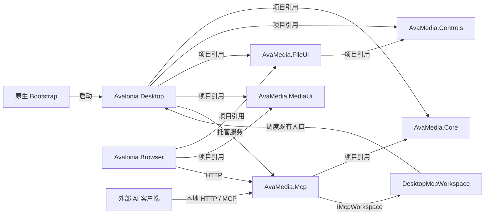

# 架构与接口层

更新：2026-10-13。本文记录当前模块、依赖方向与生命周期；界面约束由 [UISPEC.MD](../UISPEC.MD) 维护，逐项覆盖见 [工具界面](TOOL-INTERFACES.md)，历史源码审查见 [界面源码审查](UI-DESIGN-REVIEW.md)。开发与检查范围以 [AGENTS.md](../AGENTS.md) 为准。

## 模块与依赖

| 模块 | 职责 | 边界与入口 |
| --- | --- | --- |
| `AvaMedia.Core` | 工具目录、媒体参数与校验、任务计划与执行、队列、存储、模型与结果 | 不引用 Avalonia；`Catalog.All`、`QueueService`、`Storage`、`MediaEngine` |
| `AvaMedia.Controls` | 通用控件、具名主题、默认令牌与动效契约 | 仅依赖 Avalonia / Themes.Simple，可独立打包，不引用业务项目 |
| `AvaMedia.FileUi` | 文件浏览、路径输入、文件树与导入操作 | 引用 Controls / Avalonia，通过 `IFileBrowserSource` 接入本地或服务器目录，不引用 Core / Desktop |
| `AvaMedia.MediaUi` | 剪辑时间线、预览、裁剪与区域编辑等共享控件 | 仅依赖 Avalonia；通过宿主提供的媒体数据与回调工作 |
| `AvaMedia.Mcp` | MCP HTTP 服务、网页接口、文件与请求校验、服务器媒体预览 | 引用 Core / ASP.NET Core；通过 `IMcpWorkspace` 接入宿主的真实队列，不创建另一份队列 |
| `AvaMedia.Desktop` | 窗口、预览、皮肤、交互、平台播放、应用级下载与通知 | 引用 Core / MCP / Controls / FileUi / MediaUi；`MainWindow` 组合服务，`DesktopMcpWorkspace` 将外部操作调度到既有入口 |
| `AvaMedia.Browser` | Avalonia WebAssembly 远程管理客户端 | 引用 FileUi / MediaUi；通过 HTTP 操作服务器文件与队列，不把 Core 的本地进程、磁盘或推理服务带入浏览器 |
| `AvaMedia.Bootstrap` | CLR 启动前的运行时安装、原生首次配置与启动 | Windows C / macOS Objective-C；通过待应用配置交接给 `FirstRunSetup`，不承载媒体业务 |
| `scripts/`、平台打包目录 | 编译、媒体工具构建、安装器与 Release | 版本、品牌与依赖配方统一；发布流程见 [RELEASE.md](RELEASE.md) |
| `tests/`、`docs/acceptance/` | 专项验证入口与注明环境的历史证据 | 不参与产品运行；存在验证入口不表示默认执行，也不表示当前版本已验收 |

项目依赖单向；图中的 MCP 回调是宿主注入的接口实现，不是 MCP 对 Desktop 的程序集引用。服务配置、认证和工具契约见 [MCP](MCP.md)。

Browser 从 Core 的 `AiProgressContract.cs` 提取共享 DTO 声明，并链接桌面的 Lucide 与语言资源；这些共享源不构成对 Desktop / Core 程序集的引用。Browser 的发布 `wwwroot` 由桌面项目复制并通过同一 HTTP 服务提供；普通桌面编译不会自动生成浏览器发布资源。`website/` 是独立宣传页，不承担远程管理。

## 工具、任务与结果流转

`Catalog.All` 是工具 ID、分类和输出格式的来源，`Catalog.IsBeta` 定义工具的 Beta 标记。`FeatureNavigation` 将目录的六类映射为侧栏五类单开手风琴，光盘作为工具集内的分组，内部后台任务隐藏。`MediaFileRouter.Accepts / Routes` 决定文件接收条件，`MainWindow.Configure` 打开对应工作区。格式别名可以共用一个路由卡片；链接下载和设备输入有独立入口。不能从路由卡片数推断工具数量。

- 配置窗口通过 `ToolExecution.ShowAsync / Complete` 以非模态方式交接请求；`AddToolJobs` 提交主队列。关闭配置或结果窗口不等于取消已提交任务。
- 转换与导出先校验参数、来源和输出计划，再创建任务；`OutputPreferences` 统一输出位置、命名与源文件保护。人物、字幕和方向识别结果经人工调整后再创建导出任务。
- `QueueService` 在后台调用执行器，按工具调度，暂停保留任务与已有结果；原生调用在安全边界协作暂停。界面立即反馈指令，迟到回调不能撤销暂停或覆盖新请求。
- `Storage.SaveJobsAsync` 在后台序列化、原子替换队列，以递增版本阻止旧保存覆盖新编辑；退出等待最终 `PersistenceReady`。MCP 创建的任务共用这些状态和持久化，并显示 `MCP` 来源。
- AI 结果独立保存，部分结果明确标记；来源指纹在恢复、预览或提交时重查。关闭结果视图释放订阅与预览，不销毁队列任务。

并发、占用、部分结果和停止语义见 [异步任务架构](ASYNC-TASK-ARCHITECTURE.md)、[任务管理](TASK-MANAGEMENT.md) 与 [工具界面](TOOL-INTERFACES.md)。

## 呈现层与共享组件

| 层 | 实现入口 | 责任 |
| --- | --- | --- |
| 基础模板与通用组件 | `App.axaml` → `SimpleTheme` → `AvaMedia.Controls/Themes/Components.axaml` | 控件行为、具名主题、组合控件、默认令牌、焦点及基本状态 |
| 语义与平台资源 | `Styles/UiStyles.axaml`、`PlatformTokenLayer`、`Styles/ComponentSkins.axaml` | 表面、文字、状态色、平台字体与度量、皮肤资源覆盖 |
| 组件角色 | `Styles/ControlRoles.axaml`、`Ui` | `primary`、`dialog-action`、`field-action`、`transport`、时间、预览与字段名称 |
| 工作区约束 | `EditorStyles`、`PlayerStyles`、`SettingsStyles`、`VideoSummaryStyles` | 本工作区的对齐与结构，不复制通用皮肤指标 |
| 皮肤 | `Skin`、`Platinum*.axaml`、`WindowsXP*.axaml` | 应用主题、经典控件与窗口装饰；按需加载经典资源 |
| 语言与布局稳定 | `Localization`、`StableLayout`、`OverflowTip` | 完整资源键、用户数据保护、动态文案预留、仅在省略时补全文本提示 |
| 动效 | `Motion.cs`、`Styles/Motion.axaml` | 统一时长、减少动效、取消和隐藏生命周期 |
| 媒体交互 | `Controls/`、`PreviewRequest`、`EditorTime` | 等比预览、时间轴、裁剪、波形与请求/位图所有权 |

颜色和通用指标使用动态资源，窗口使用角色；媒体画面、功能插画、经典皮肤绘制配色属于明确例外。浅 / 深色主按钮使用强调色及独立悬停 / 按压色；Mac OS 9 和 XP 使用各自默认按钮面。默认动作由调用处明确设置，不能因自定义文案自动把破坏性动作绑定到 Enter。

表单标签、输入、浏览及底部动作遵循同一规范。`Ui.Parameter` 为输入及派生数值滑条提供字段名称；图标、列表复选框与自绘交互仍须分别提供名称和键盘等价操作。动态状态使用预留格，只有用户切换页面、展开、添加或移除内容时才重排。

## 生命周期与所有权

| 对象 | 所有者 | 释放 / 取消边界 |
| --- | --- | --- |
| 媒体和 AI 任务 | 主队列 | 停止 / 结束任务或真正退出；工具窗口关闭不取消 |
| 设置草稿与未提交编辑 | 对应窗口 | 应用 / 确定提交；取消不撤回此前已应用的设置 |
| 模型下载 | `ModelDownloads.Shared` / 应用 | 主动停止或应用退出；关闭设置或通知继续下载 |
| 更新下载与安装准备 | `ApplicationUpdater` | 按更新选项取消；仅正常退出安装，托盘隐藏不安装 |
| 当前预览请求与静态位图 | 对应视图 / `PreviewRequest` | 切换来源取消旧请求，迟到结果丢弃；移除或关闭释放 |
| 流式画面与音频 | `IPlaybackSession` / `Playback` | 播放会话拥有帧；隐藏停止像素交付，保持时钟与音频 |
| 界面订阅、动画与刷新计时器 | 对应控件或窗口 | 隐藏 / 离开视觉树暂停适用刷新；关闭解除订阅 |
| 通知记录 | `NotificationCenter.Shared` | 用户移除记录；关闭气泡与任务控制分开 |

同一属性或资源只保留一个负责人。窗口不直接管理外部进程与模型文件租约，不在 UI 线程同步等待推理、探测、解码或磁盘读取。

## 可替换接口

| 接口 | 职责 | 调用方 |
| --- | --- | --- |
| `IJobExecutor` | 执行、真实进度和取消 | `QueueService` |
| `IImageCompressor` | 静态图探测、编码、体积与尺寸、防覆盖 | 图片压缩窗口和队列执行器，共用 `ImageCompressor` |
| `IMediaPreview` | 缩略图、边界帧、相邻帧时间 | 编辑器及其他媒体预览 |
| `IMediaEngine` | 执行与预览契约、探测、设置和工具路径 | 主窗口、转换、编辑、播放与批量工具 |
| `IVideoOrientationDetector` | 方向建议、证据、进度与取消 | 编辑器方向页、批量旋转 |
| `ISummaryModel` / `ISummaryToolModel` | 文本、多图、结构化输出与多轮工具请求 | 视频总结、画面描述、指定时间取帧 |
| `IPlaybackSession` | 首帧、时钟、定位、播放控制、可见性与释放 | 独立播放器；生产实现 `Playback` |
| `IAudioOutput` | PCM、暂停、音量、停止与释放 | Desktop 内部的 WaveOut / AudioQueue 适配 |
| `IMediaFileRouter` | 接收条件、匹配来源和路由选项 | 文件路由窗口 |
| `IMcpWorkspace` | 协议操作与既有桌面任务的交接 | `McpService` / `McpTools` |

生产媒体实现为 `MediaEngine`；窗口通过构造参数依赖接口。静态参数校验、格式判断和命名保持纯业务规则，不增加仅做转发的接口。

## 媒体、模型与平台实现

### 预览与播放

图片查看、静态图压缩、导出、效果和缩略图共用 `ImageCodec` 的编解码、方向、颜色与并发限制。`PreviewCacheStore` 统一派生图和任务摘要的容量、完整性校验与原子写入；`TaskPreviewCache` 负责选轨与截取位置。普通静态图压缩不依赖媒体子进程；HEIF、高位深 PNG、PDF、APNG 和 AI 图像处理保留专门路径。

`HeifImage` 从 FFprobe 选择静态主图，识别 Tile Grid、方向、位深及派生裁剪；`AppleImageIO` 在 macOS 延迟加载，通过 SafeHandle 管理资源并在后台按请求尺寸下采样。窗口不直接调用这些原生 API。见 [HEIC](HEIC.md)。

编辑器与播放器共用 `PreviewRequest` 的过期取消、`MediaFrameView` 的位图所有权及 `EditorTime` 的刷新节流。`MediaPreviewCache` 的标识含源路径、大小、修改时间、轨道、尺寸、定位方式及工具路径；相同请求合并生成，视频预览最多两个并发。单项上限 8 MB，总体 16 MB 内存 / 128 MB 磁盘；媒体探测仅在内存中限量保留。

`PresentationVisible` 控制视频像素交付；隐藏 / 最小化保留时钟和音频，恢复沿用当前会话。BGRA 缓冲由播放会话持有并复用，释放随会话结束；时间文字与滑块最多每秒刷新十次，画面按源帧率呈现。`ProcessRunner.StartAsync` 把进程创建移出 UI 线程；已在后台的播放解码仍使用同步创建。探测完整读取结构化 JSON，普通进程日志保留长度限制。

### 模型与数据

AI 文本与视觉共用 `SummaryChatProtocol`；`SummaryToolConversation` 管理工具回合。`MediaCaptionSession` 在批次内复用模型，借用方不负责销毁共享模型。模型准备与推理的共享资源在后台协调；下载、导入、修复与删除保留独占文件保护。当前加速和预热语义见 [模型加速](MODEL-ACCELERATION.md)、[模型管理](MODELS.md)。

任务行用 `MetadataReady` 跟踪后台文件大小读取，进度只通知状态字段。SHA256 使用 `FileHashing` 流式读取、池化 1 MiB 缓冲、节流进度和取消。

### 格式与系统集成

`VideoFormats` 是视频输入分类来源，播放器目录扫描、路由、剪辑、压缩、批量工具与 Windows 打开方式共用；原格式导出容器单独维护。3GP / 3G2 复用转换接口，安装与 macOS 构建共用 `scripts/legacy-video-capabilities.json`。见 [旧视频支持](LEGACY-VIDEO.md)。

Windows 打开方式由 `SystemPlayerIntegration` 管理当前用户的 Applications / ProgID / Capabilities，激活命令为 `--play`；开始菜单和卸载由安装器管理。macOS 文件类型由打包声明并经应用文件激活进入播放器；独立播放窗口通过 `ShowForPlayback` 打开。系统默认应用仍由用户选择。

WiFi 服务由 Desktop 托管，扫码网页在 `WifiTransfer/index.html`；原生首次配置与该网页各自使用平台 / 浏览器控件，不套用 Avalonia 模板。功能与约束见 [WiFi 传文件](WIFI-TRANSFER.md)、[首次使用](FIRST-RUN-SETUP.md)。

## 文档与证据的维护

架构描述模块和所有权；`UISPEC.MD` 定义当前设计规则；各功能文档记录操作和限制；`docs/acceptance/` 只保存注明日期和范围的证据。历史截图、专项测试入口、旧平台数据不能直接作为当前版本全部界面的通过结论。源码修改默认只构建受影响项目和执行必要静态诊断，实际界面、媒体及性能验证按用户明确要求进行。
